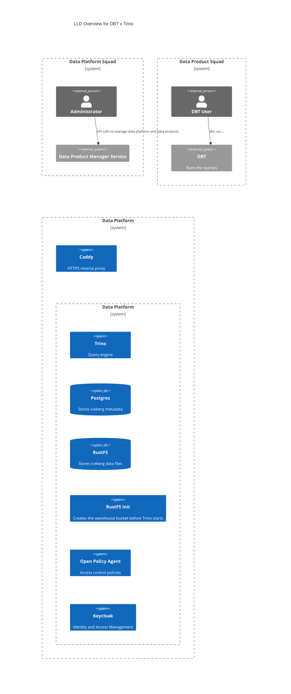

# Low-Level Design (LLD) for DBT with Trino and Iceberg

# LLD Overview

# Services details

## Caddy

### Roles

- HTTPS reverse proxy for Trino, RustFS, OPA, and Keycloak services.
- Manages TLS certificates using self-signed certificates for local development.
- Routes incoming requests to the appropriate backend services based on the domain.

### Detailed view

Routing rules:
- rustfs.127.0.0.1.nip.io -> RustFS S3 API
- console.rustfs.127.0.0.1.nip.io -> RustFS Console
- trino.127.0.0.1.nip.io -> Trino service
- auth.127.0.0.1.nip.io -> Keycloak service
- opa.127.0.0.1.nip.io -> Open Policy Agent service

> Why ".nip.io"?
> ".nip.io" is a free wildcard DNS service that maps any subdomain to the specified IP address
> It becomes handy for local development and testing, allowing easy access to services running on localhost without needing to modify the hosts file.

### Interactions

- Receives incoming HTTPS requests on port 443.
- Routes requests to the appropriate backend service based on the requested domain.
- Handles TLS termination, ensuring secure communication between clients and backend services.

## Keycloak

### Roles

- Identity and Access Management (IAM) service for authentication and authorization.
- Manages user identities, roles, groups and users metadata.
- Provides Single Sign-On (SSO) capabilities for Trino.

### Detailed view

Realms:
- master: Default realm for Keycloak administration.
  - clients:
    - trino: Client configuration for Trino to integrate with Keycloak for authentication.
  - client scopes:
    - groups: Scope to include user groups information in the tokens issued to Trino. (["group1", "group2/subgroup1", ...])
  - **TBC**

### Interactions

- Trino redirects users to Keycloak for authentication.
- Keycloak authenticates users and issues tokens for Trino with users groups information.
- Keycloak redirects users back to Trino after successful authentication.

## Open Policy Agent

### Roles
### Detailed view
### Interactions

## RustFS

### Roles
### Detailed view
### Interactions

## RustFS init

### Roles
### Detailed view
### Interactions

## Postgres

### Roles
### Detailed view
### Interactions

## Trino

### Roles
### Detailed view
### Interactions
