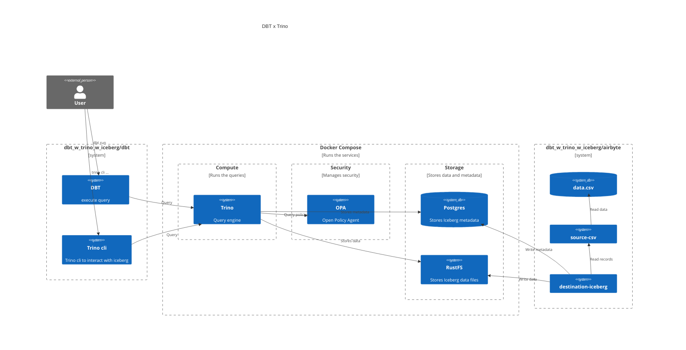

# *⚠ OUTDATED README ⚠* -- new version coming soon (or late)

# Getting started

## Preriquisites
- [uv](https://docs.astral.sh/uv/)
- [docker-compose](https://rancherdesktop.io/)

## Start trino server
From the repository root, start Trino and its dependencies.
If you have an existing MinIO warehouse, [copy its objects first](#migrate-an-existing-minio-warehouse).

```bash
env UID="$(id -u)" GID="$(id -g)" docker compose up -d trino
```

Compose stores RustFS objects in the `rustfs_data` volume and creates `s3://warehouse` before Trino starts. The S3 API is available at `https://rustfs.127.0.0.1.nip.io` and the console at `https://console.rustfs.127.0.0.1.nip.io/rustfs/console/`. Use the local credentials from `compose.yml` to sign in.

### Migrate an existing MinIO warehouse

Stop writes from Trino and Airbyte. Keep the PostgreSQL catalog and the `rw_volumes/minio_volume` directory. The catalog points to the existing object keys under `s3://warehouse`, so copy those objects through the S3 API before restarting Trino.

Start RustFS and create a temporary copy of the old volume. Run these commands from the repository root.

```bash
env UID="$(id -u)" GID="$(id -g)" docker compose up -d --wait rustfs
docker volume create minio_migration_data
docker run --rm --user 0 --entrypoint /bin/sh \
  --mount "type=bind,src=$PWD/rw_volumes/minio_volume,dst=/source,readonly" \
  --mount type=volume,src=minio_migration_data,dst=/data \
  rustfs/rc:v0.1.37 -ec 'cp -a /source/. /data/'
```

If you have a locally cached MinIO image, use its name in the `docker run` command below. Otherwise, build the same version from source.

```bash
docker build -t local/warehouse-minio:20241013 - <<'DOCKERFILE'
FROM golang:1.23.12-bookworm AS build
RUN CGO_ENABLED=0 GOMAXPROCS=2 go install github.com/minio/minio@RELEASE.2024-10-13T13-34-11Z
FROM rustfs/rc:v0.1.37
USER 0
COPY --from=build /go/bin/minio /usr/local/bin/minio
ENTRYPOINT ["/usr/local/bin/minio"]
DOCKERFILE
```

Run the temporary MinIO server on the Compose network and wait for its S3 API to start. Use the legacy credentials if they differ from the old defaults.

```bash
compose_network=$(env UID="$(id -u)" GID="$(id -g)" docker compose config --format json |
  python3 -c 'import json,sys; print(json.load(sys.stdin)["networks"]["default"]["name"])')
docker run -d --rm --name minio-migration --network "$compose_network" \
  --mount type=volume,src=minio_migration_data,dst=/data \
  local/warehouse-minio:20241013 server /data

env UID="$(id -u)" GID="$(id -g)" docker compose run --rm -T --entrypoint /bin/sh rustfs_init -ec '
  rc alias set old http://minio-migration:9000 minioadmin minioadmin --region us-east-1 --bucket-lookup path
  rc alias set rustfs http://rustfs:9000 "$RUSTFS_ACCESS_KEY" "$RUSTFS_SECRET_KEY" --region us-east-1 --bucket-lookup path
  rc bucket create rustfs/warehouse --ignore-existing
  rc mirror old/warehouse rustfs/warehouse
  rc diff --recursive --diff-only old/warehouse rustfs/warehouse
'
```

When the comparison shows no differences, start Trino with the command above and query an existing table. Then stop `minio-migration` and remove the temporary `minio_migration_data` volume.

## Data products as code

The isolated [data platform pilot](tools/data_product_manager/README.md) provisions Keycloak, Iceberg and OPA from a Git manifest.

## Setup dbt
Run the following command to setup the dbt environment
```bash
cd dbt_w_trino_w_iceberg/dbt
uv run dbt deps
```

## Run dbt
Run the following command to run dbt
```bash
cd dbt_w_trino_w_iceberg/dbt
uv run dbt build
```

## Check results
```bash
trino --catalog mydata https://trino.127.0.0.1.nip.io --external-authentication --insecure --external-authentication-redirect-handler DESKTOP_OPEN
```

```sql
trino> select * from dbt.any_to_any_v1_0;
 from_currency | to_currency |        rate        
---------------+-------------+--------------------
 EUR           | EUR         |                1.0 
 GBP           | EUR         | 1.4285714285714286 
 USD           | EUR         | 0.7692307692307692 
 EUR           | GBP         |                0.7 
 GBP           | GBP         |                1.0 
 USD           | GBP         | 0.5384615384615384 
 EUR           | USD         |                1.3 
 GBP           | USD         | 1.8571428571428574 
 USD           | USD         |                1.0 
(9 rows)
```

## Run airbyte integration

Run the source connector from the repository root.

```bash
bash airbyte/ingest.sh
```

To write the records to Iceberg, uncomment `| write_data` on the last line of `airbyte/ingest.sh`. The destination runs on the Compose network and connects to PostgreSQL and RustFS.

## Check airbyte ingestion worked and is available in trino
```bash
cd dbt_w_trino_w_iceberg/dbt
dbt show --inline 'select * from {{ source("airbyte", "airbyte_raw_data") }}'
```

# System overview

